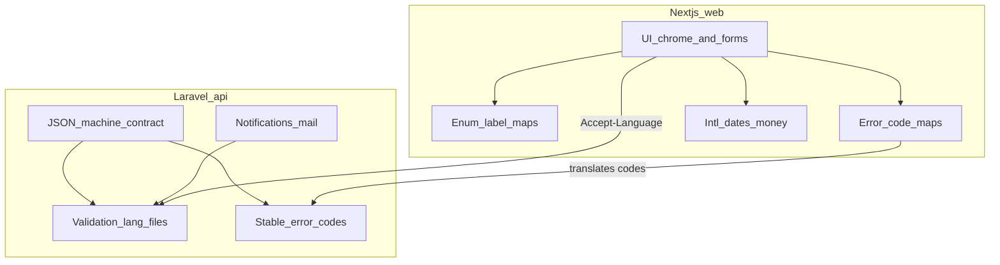
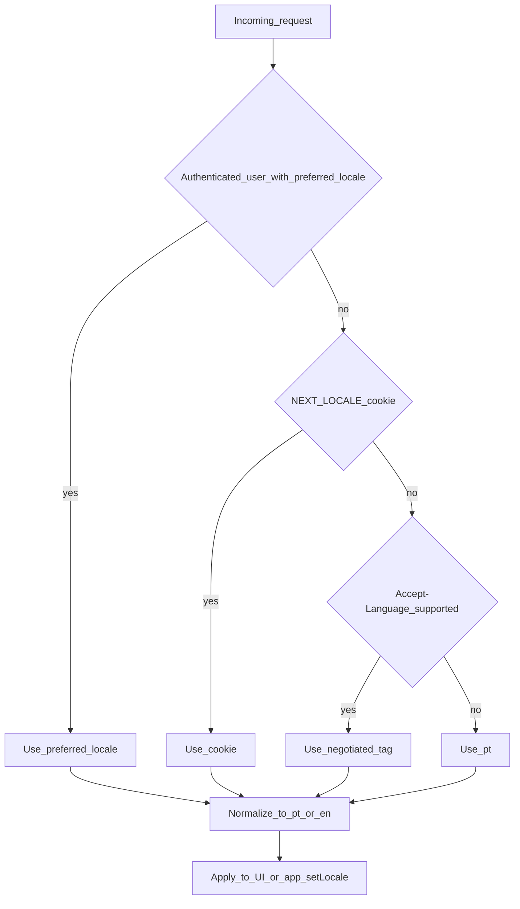
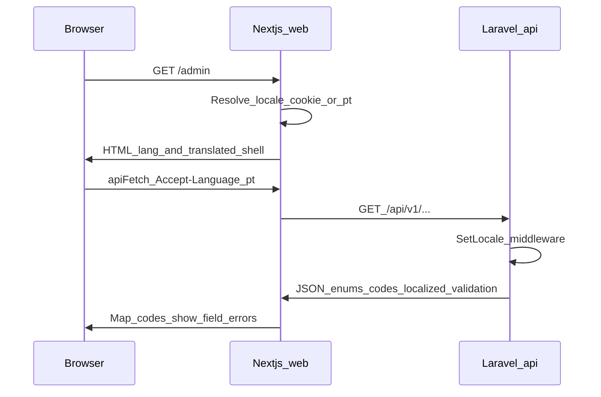

# Internationalization (PT/EN) — Implementation Plan

**Status:** Specification (not yet implemented)  
**Scope:** `apps/api` (Laravel) + `apps/web` (Next.js)  
**Related ADR:** [ADR-0010](./adr/0010-i18n-pt-en.md)  
**Date:** 2026-03-25

This document is the technical specification for introducing Portuguese (`pt`) and English (`en`) localization. It is grounded in the current AACT codebase. It does **not** authorize implementation by itself; implementers should follow the phased roadmap and acceptance criteria below.

**Legend**

| Marker | Meaning |
| --- | --- |
| **Fact** | Verified in the repository at planning time |
| **Recommendation** | Architectural decision locked by this plan |
| **Assumption** | Reasonable inference; confirm if product constraints change |
| **Clarification** | Was open; resolved by this plan |

---

## 1. Executive summary

AACT is a same-origin modular monolith (Nginx → Laravel API + Next.js UI). The UI is fixed European Portuguese; the API speaks mostly English in validation and domain errors; emails are hardcoded Portuguese. There is no translation infrastructure, locale negotiation, user language preference, or shared FE/API locale contract.

**Recommendation:** Introduce a **presentation-first** i18n model:

1. **Next.js owns** almost all UI strings (navigation, forms, help, enum labels, toast/empty states) via **next-intl**, with locales `pt` / `en`, default **`pt`**, and **no URL locale prefix** (`localePrefix: 'never'`).
2. **Laravel owns** mail/notification copy and built-in validation message catalogs, negotiated via **`Accept-Language`** (plus future `users.preferred_locale` for queued mail).
3. **API contract stays machine-readable:** enums and statuses remain English identifiers; custom errors grow a stable **`code`** (already used in middleware); the web maps codes to translations. Do **not** couple the API to frontend translation keys.
4. **Do not** introduce multilingual database tables for business names, help, or user-generated content. Treat persisted free-text `status_reason` / ledger descriptions as historical English; migrate toward **reason codes** incrementally.

This is the simplest architecture that fits an authenticated admin/portal product, preserves invitation deep links, avoids duplicate translation ownership, and allows a third language later without rewriting routing.

---

## 2. Existing architecture assessment

### 2.1 Runtime topology (**Fact**)

From [architecture.md](./architecture.md):

```text
Browser
  └─ Nginx (:8080)
       ├─ /api/*, /sanctum/*, /up  → Laravel php-fpm
       └─ /*                      → Next.js
```

Trust boundary: Sanctum cookie sessions for humans; bearer + HMAC for integrations. Frontend route guards are UX only; authorization is server-side.

### 2.2 API — Laravel (**Fact**)

| Item | Finding |
| --- | --- |
| Framework | Laravel `^13.17`, PHP `^8.3`, Sanctum `^4.0` ([apps/api/composer.json](../apps/api/composer.json)) |
| Structure | `Http/Controllers/Api/V1/{Admin,Auth,Integration,Portal}`, `Services/*`, `Resources`, `Enums`, `Policies`, `Notifications`, `Middleware` |
| Absent layers | No `app/Actions`, no Form Requests, no custom `app/Exceptions` handler, no `app/Mail` / `app/Jobs` |
| Locale config | `locale` / `fallback_locale` / `faker_locale` in [config/app.php](../apps/api/config/app.php); defaults **`en`** |
| Catalogs | No `lang/` or `resources/lang/`; no application `__()` / `trans()` usage |
| Negotiation | No `Accept-Language` middleware; no `Content-Language` |
| User preference | No `locale` / `preferred_locale` on `User` |
| Tests | PHPUnit Feature / Unit / Financial; no Pest |
| Docs | [openapi.yaml](./openapi.yaml) — no locale headers or error-code schema |

Successful responses mix Laravel Resources (`data` / pagination) and ad-hoc JSON (`status`, integration ingestion shapes). Errors: standard Laravel 422 `{ message, errors }`; auth middleware JSON `{ message, code }`.

### 2.3 Web — Next.js (**Fact**)

| Item | Finding |
| --- | --- |
| Framework | Next.js `16.4.5`, React `19.3.0`, App Router only ([apps/web/package.json](../apps/web/package.json)) |
| i18n deps | None (`next-intl`, i18next, FormatJS, Lingui absent) |
| Routing | No `middleware.ts`, no `[locale]` segment; routes under `src/app` (`/login`, `/admin/*`, `/portal/*`) |
| Document lang | Hardcoded `<html lang="pt-PT">` in [layout.tsx](../apps/web/src/app/layout.tsx) |
| Metadata | Single global `metadata`; PT description; no `alternates.languages` |
| API client | [lib/api.ts](../apps/web/src/lib/api.ts) — CSRF + `Accept: application/json`; **no** `Accept-Language` |
| Validation | Native HTML + [lib/iban.ts](../apps/web/src/lib/iban.ts); no Zod/RHF |
| Dates | `toLocaleString("pt-PT")` in multiple admin/portal pages |
| Money | Often raw `*_minor` integers |
| Unit tests | None in `apps/web` |
| E2E | Playwright in [e2e/](../e2e/) asserts Portuguese copy |

UI copy is densely hardcoded European Portuguese (shell, login/MFA, admin/portal pages, help catalog), with English domain terms mixed in (`Businesses`, `Memberships`, `referrer`).

### 2.4 Language inconsistency today (**Fact**)

| Surface | Language |
| --- | --- |
| Next.js UI | Portuguese (`pt-PT`) |
| API validation / domain exceptions | English |
| Middleware `{ message, code }` | English messages |
| `EmailOtpNotification`, `ReferrerInvitationNotification` | Portuguese |
| Persisted `status_reason`, ledger `description` | English |
| Enum machine values | English identifiers |

The product is **mixed-language**, not localized.

---

## 3. Current-state findings and file index

### 3.1 High-impact API files

| Path | Relevance |
| --- | --- |
| [apps/api/config/app.php](../apps/api/config/app.php) | Locale defaults (`en`) |
| [apps/api/bootstrap/app.php](../apps/api/bootstrap/app.php) | Middleware aliases; JSON exception rendering for `api/*` |
| [apps/api/app/Http/Middleware/EnsureFullyAuthenticated.php](../apps/api/app/Http/Middleware/EnsureFullyAuthenticated.php) | `{ message, code: mfa_setup_only }` pattern |
| [apps/api/app/Http/Middleware/EnsureAdminAccess.php](../apps/api/app/Http/Middleware/EnsureAdminAccess.php) | `{ message, code: forbidden }` |
| [apps/api/app/Http/Middleware/EnsureStepUp.php](../apps/api/app/Http/Middleware/EnsureStepUp.php) | Step-up `{ message, code }` |
| [apps/api/app/Services/Auth/LoginService.php](../apps/api/app/Services/Auth/LoginService.php) | Hardcoded auth validation messages |
| [apps/api/app/Services/Onboarding/*.php](../apps/api/app/Services/Onboarding) | Invitation / payment / membership English exceptions |
| [apps/api/app/Services/Settlement/PayoutRequestService.php](../apps/api/app/Services/Settlement/PayoutRequestService.php) | Domain validation strings + `status_reason` |
| [apps/api/app/Services/Integration/EventIngestionService.php](../apps/api/app/Services/Integration/EventIngestionService.php) | Persisted English failure reasons |
| [apps/api/app/Services/Ledger/LedgerService.php](../apps/api/app/Services/Ledger/LedgerService.php) | English ledger descriptions |
| [apps/api/app/Notifications/EmailOtpNotification.php](../apps/api/app/Notifications/EmailOtpNotification.php) | Hardcoded PT mail |
| [apps/api/app/Notifications/ReferrerInvitationNotification.php](../apps/api/app/Notifications/ReferrerInvitationNotification.php) | Hardcoded PT mail |
| [apps/api/app/Enums/*.php](../apps/api/app/Enums) | 12 string-backed enums (machine values only) |
| [apps/api/routes/api.php](../apps/api/routes/api.php) | API surface |

### 3.2 High-impact web files

| Path | Relevance |
| --- | --- |
| [apps/web/src/app/layout.tsx](../apps/web/src/app/layout.tsx) | Fixed `lang`, metadata |
| [apps/web/src/lib/nav.ts](../apps/web/src/lib/nav.ts) | Central nav/breadcrumb PT labels |
| [apps/web/src/lib/api.ts](../apps/web/src/lib/api.ts) | Headers + error `message` surfacing |
| [apps/web/src/lib/auth.ts](../apps/web/src/lib/auth.ts) | Sanctum session helpers |
| [apps/web/src/lib/iban.ts](../apps/web/src/lib/iban.ts) | PT validation messages |
| [apps/web/src/content/help/index.ts](../apps/web/src/content/help/index.ts) | Large PT help catalog |
| [apps/web/src/components/shell/*](../apps/web/src/components/shell) | Sidebar / AccountMenu a11y + labels |
| [apps/web/src/app/login/page.tsx](../apps/web/src/app/login/page.tsx) | Auth UI copy |
| [apps/web/src/app/login/mfa/page.tsx](../apps/web/src/app/login/mfa/page.tsx) | MFA UI copy |
| [apps/web/src/app/portal/(shell)/page.tsx](../apps/web/src/app/portal/(shell)/page.tsx) | Dense portal forms/copy |
| Admin pages under `src/app/admin/**` | Forms, confirms, alerts |
| [e2e/tests/auth-flows.spec.ts](../e2e/tests/auth-flows.spec.ts) | PT-dependent selectors |
| [e2e/tests/public-a11y.spec.ts](../e2e/tests/public-a11y.spec.ts) | PT-dependent public assertions |

### 3.3 What does **not** exist (**Fact**)

- Translation catalogs (FE or BE)
- Language switcher
- Locale cookie / user preference
- Shared error-code → UI mapping
- Field-level API error rendering in the UI (`payload.errors` typed but unused)
- Multilingual DB schema

---

## 4. API vs UI localization responsibility matrix

### 4.1 Design principle (**Recommendation**)

Separate three layers:

1. **Machine-readable API contract** — status codes, enum values, error `code`, IDs, money minor units, ISO currency.
2. **Domain / business information** — names, notes, user-authored text; language of the author; not system-translated.
3. **Human-readable presentation** — UI chrome and mail bodies; translated in the layer that owns the audience.

The API must not become a translation server for Next.js screens.

### 4.2 Responsibility matrix (**Recommendation**)

| Concern | Owner | Mechanism | Notes |
| --- | --- | --- | --- |
| Nav, buttons, titles, empty/loading/error chrome | Web | next-intl | Primary workload |
| Help content | Web | `messages/help/{locale}.json` | Migrate from `content/help` |
| Client-side IBAN / HTML validation copy | Web | next-intl | Keep offline of API |
| Enum / status **labels** | Web | `enums.*` keys keyed by machine value | API keeps raw enum strings |
| Built-in Laravel rule messages (`required`, `email`, …) | API | `lang/{locale}/validation.php` | Via request locale |
| Domain/auth human messages for SPA | Prefer **code** on API; **translate on Web** | `{ code, params?, message }` | `message` = localized fallback / non-SPA clients |
| Middleware authz failures | API `code` + Web map | Extend existing pattern | e.g. `mfa_setup_only` |
| Email / queued notifications | API | Laravel `__()` + notifiable locale | Audience is inbox, not Next.js |
| Password reset / verify email (framework) | API | Laravel lang `passwords` / `auth` | Same locale rules |
| Dates, numbers, currency formatting | Web | `Intl` (`pt-PT` / `en-GB`) | API stays UTC + minor units |
| Business/user/website names, review notes | Neither | Store as authored | No translation tables |
| Integration API consumers | Machine contract only | English identifiers + codes | Do not require Accept-Language for correctness |
| Persisted ledger descriptions / free-text reasons | Presentation later / codes | See §9 | Do not dual-store PT/EN rows |

### 4.3 Boundary diagram



### 4.4 Alternatives considered for API messages

| Approach | Pros | Cons | Verdict |
| --- | --- | --- | --- |
| A. API returns only localized `message` | Simple for current UI | Couples API to UI language; weak for integrations; duplicates FE catalogs | Reject as sole strategy |
| B. API returns only translation keys | FE owns all copy | Leaks FE key structure into API; bad for non-Next clients | Reject |
| C. API returns stable `code` (+ params); optional localized `message` | Clear contract; FE maps; mail still localizable | Requires catalog of codes; incremental migration | **Adopt** |
| D. Dual: Laravel validates in locale; domain uses codes | Uses framework strengths; avoids FE owning rule grammar | Two translation stores for overlapping concepts | **Adopt hybrid** (validation via Laravel; domain via codes) |

**Decision:** Hybrid **C+D**. Validation grammar lives in Laravel lang files. Domain/authz use stable codes with FE translation; Laravel may still fill `message` for the active locale as a readable fallback.

---

## 5. Evaluation of i18n libraries and approaches

### 5.1 Frontend alternatives

| Option | Fit for AACT | Pros | Cons |
| --- | --- | --- | --- |
| **next-intl** | Strong | App Router + RSC; ICU; TypeScript keys; cookie locale without URL prefix | New dependency |
| react-i18next / next-i18next | Weak–medium | Mature | Pages-Router heritage; more wiring for App Router + RSC |
| FormatJS / react-intl | Medium | Excellent ICU | Heavier DIY for Next routing/SSR locale |
| Custom JSON + React context | Weak | No dependency | Reinvents pluralization, SSR, missing-key tooling |
| Native Next.js only | Insufficient | Zero deps | No message catalogs, pluralization, or DX |

**Decision:** **next-intl**.

**Routing mode:** `localePrefix: 'never'`.

| URL prefix (`/pt/admin`) | Cookie-only locale |
| --- | --- |
| Better public SEO / shareable locale URLs | Preserves existing paths and invitation links |
| Requires rewriting every route + auth redirects | Matches authenticated admin/portal product |
| Risk to Sanctum/cookie mental model if paths change | SEO secondary for this product |

**Clarification resolved:** No locale segment in URLs. Update `<html lang>` and metadata from the active locale instead.

### 5.2 Backend approach

Use Laravel’s built-in localization (`lang/{locale}/*.php`, `__()`, `trans_choice`). No third-party i18n package.

Publish / maintain:

- Framework-style `validation.php`, `auth.php`, `passwords.php` for `pt` and `en`
- App files: `notifications.php`, `errors.php` (and optionally `mail.php`)

---

## 6. Recommended translation resource architecture

### 6.1 Comparison of organization strategies

| Option | Maintainability | Scale | DX | Perf | Verdict |
| --- | --- | --- | --- | --- | --- |
| **A** Single file all languages | Poor | Poor | Collisions | Loads everything | Reject |
| **B** One file per language | Good for mid-size | OK | Easy diff EN↔PT | Fine for this app | Base choice |
| **C** Per language × domain folders | Best semantic split | Best long-term | More files to sync | Can lazy-load | Overkill for current size except help |
| **B+** Per language + separate help | Best balance | Good | Clear ownership of large help corpus | Load help when needed | **Adopt** |

### 6.2 Target layout (**Recommendation**)

```text
apps/web/messages/
  pt.json
  en.json
  help/
    pt.json
    en.json

apps/api/lang/
  pt/
    validation.php
    auth.php
    passwords.php
    notifications.php
    errors.php
  en/
    validation.php
    auth.php
    passwords.php
    notifications.php
    errors.php
```

Example web shape (`pt.json` nested namespaces):

```json
{
  "common": { "loading": "A carregar…", "save": "Guardar", "cancel": "Cancelar" },
  "nav": { "overview": "Visão geral", "operations": "Operações" },
  "auth": { "loginTitle": "Iniciar sessão", "password": "Palavra-passe" },
  "enums": {
    "membershipStatus": {
      "pending": "Pendente",
      "approved": "Aprovado",
      "rejected": "Rejeitado",
      "suspended": "Suspenso"
    }
  },
  "errors": {
    "mfa_setup_only": "Conclua a configuração MFA para continuar.",
    "forbidden": "Acesso de administrador necessário.",
    "request_failed": "Pedido falhou"
  },
  "validation": {
    "iban_country": "O IBAN deve começar com 2 letras do país (ex. PT)."
  }
}
```

### 6.3 Conventions (**Recommendation**)

| Topic | Convention |
| --- | --- |
| Namespaces | `common`, `nav`, `auth`, `admin`, `portal`, `enums`, `errors`, `validation`, `help` |
| Key naming | `camelCase` leaf keys; nest by UI area (`admin.businesses.createTitle`) |
| Flat vs nested | **Nested** JSON (matches next-intl namespaces) |
| Dedup | Shared chrome in `common`; domain terms in glossary (§6.4); do not copy the same sentence across pages |
| Interpolation | ICU: `Olá, {name}` |
| Pluralization | ICU plural (`{count, plural, one {# item} other {# items}}`) |
| Context | Disambiguate with suffix or nested key (`status.pending` vs verb `action.pending`) |
| Rich text | Prefer structured fields (title/summary/lists) over HTML in strings; if markup needed, next-intl rich text API only |
| Missing keys | Dev: show key + warn; Prod: fallback locale `pt` then key |
| Type safety | next-intl typed messages from `pt.json` as source of truth |
| Completeness | CI script: every key in `pt.json` exists in `en.json` and vice versa |

### 6.4 Shared terminology glossary (**Recommendation**)

Keep product nouns consistent across locales (often leave English loanwords in PT UI where already established):

| Term | PT UI | EN UI | Notes |
| --- | --- | --- | --- |
| business | business | business | Domain tenant; already used in PT UI |
| referrer | referrer | referrer | Keep English |
| membership | membership | membership | Or “adesão” only if product chooses consistency later |
| payout | payout | payout | Keep English in labels where current UI does |
| commission | comissão | commission | Translate descriptive prose |
| website | website | website | Keep English |

Document changes to this glossary in PR descriptions when renaming visible terms.

---

## 7. Locale negotiation and persistence strategy

### 7.1 Supported locales (**Recommendation**)

| App locale | Intl format locale | HTML `lang` | Role |
| --- | --- | --- | --- |
| `pt` | `pt-PT` | `pt-PT` | Default; European Portuguese copy |
| `en` | `en-GB` | `en-GB` | English UI |

**Clarification resolved:** Use short tags `pt` / `en` for catalogs and negotiation (Laravel-friendly). Map to regional tags only for `Intl` and `html lang`. Do not introduce `pt-BR` unless product expands later.

**Default:** `pt` (matches current UI). Align API `APP_LOCALE` default to `pt` when implementation lands (breaking change vs today’s English validation defaults — document in changelog / `.env.example`).

**Fallback:** unsupported or missing → `pt`. Laravel `fallback_locale` should also be `pt` after cutover (or `en` only if deliberately keeping English as missing-key fallback — **prefer `pt`** for consistency with product default).

### 7.2 Priority order (**Recommendation**)

```text
1. users.preferred_locale (authenticated, when non-null)
2. Cookie NEXT_LOCALE (web) — written by language switcher / first visit detection
3. Accept-Language (explicit from apiFetch or browser)
4. Default: pt
```

Web and API must not silently diverge: **every** `apiFetch` sends `Accept-Language: <activeLocale>`. For queued notifications, use `preferred_locale` on the notifiable (else default `pt`).

### 7.3 Unauthenticated vs authenticated

| State | Web | API |
| --- | --- | --- |
| Anonymous (login, public invite) | Cookie / browser → default `pt` | `Accept-Language` only |
| Authenticated | Cookie synced with `preferred_locale` on switch | Prefer DB locale when user resolved; else header |
| Integration HMAC routes | N/A | Ignore UI locale; machine responses; optional header only if ever returning human messages |

### 7.4 SSR, caching, headers

- Next.js: resolve locale in next-intl middleware/request config from cookie; set document language per request.
- API: `SetLocale` middleware on `api/*` sets `app()->setLocale()`; response headers `Content-Language: pt|en` and `Vary: Accept-Language`.
- Avoid caching localized API JSON without `Vary: Accept-Language` (Nginx/CDN). Session HTML is mostly dynamic/client-rendered today — low CDN risk; still set correct `lang`.

### 7.5 Locale resolution diagram



---

## 8. API / UI integration design

### 8.1 How the web communicates locale

**Recommendation:** `Accept-Language` only (no `?locale=` query param, no custom `X-Locale` unless a future non-browser client needs it).

In [lib/api.ts](../apps/web/src/lib/api.ts):

```http
Accept: application/json
Accept-Language: pt
```

### 8.2 Validation errors (422)

Laravel response (unchanged shape):

```json
{
  "message": "O campo name é obrigatório.",
  "errors": {
    "name": ["O campo name é obrigatório."]
  }
}
```

**Web changes:**

1. Prefer displaying `payload.errors[field][0]` next to inputs (today unused).
2. Fallback banner: mapped `code` → `t('errors.*')`, else localized `message`, else `t('errors.request_failed')`.
3. Do **not** re-translate Laravel validation strings on the FE when the API already localized them for the requested locale.

### 8.3 Structured domain / auth errors

Existing pattern (**Fact**):

```json
{
  "message": "Full authentication required.",
  "code": "mfa_setup_only"
}
```

Target pattern (**Recommendation**):

```json
{
  "message": "É necessária autenticação completa.",
  "code": "mfa_setup_only",
  "params": {}
}
```

Web:

```text
if (code && hasTranslation(`errors.${code}`)) show t(`errors.${code}`, params)
else show message || t('errors.request_failed')
```

Representative codes to catalog early (extend as services migrate):

| Code | Origin today |
| --- | --- |
| `mfa_setup_only` | `EnsureFullyAuthenticated` |
| `forbidden` | `EnsureAdminAccess` |
| `step_up_required` | `EnsureStepUp` (confirm exact code in implementation) |
| Auth/domain codes | Introduce when replacing hardcoded `ValidationException` strings |

### 8.4 Enums

API continues to return `"status": "pending"`. Web: `t(\`enums.membershipStatus.${status}\`)`.

### 8.5 Frontend-only strings

Remain independent: nav, help, confirms (`window.confirm`), IBAN messages, loading labels. Never require a Laravel round-trip to translate chrome.

### 8.6 Sequence



### 8.7 Avoiding duplicate responsibilities

| Do | Don't |
| --- | --- |
| Translate UI chrome once in next-intl | Copy the same sentence into Laravel `errors.php` and `pt.json` without need |
| Keep enum labels only in the web | Return localized label fields from Resources |
| Localize mail only in Laravel | Render email bodies in Next.js |
| Persist reason **codes** for new domain events | Persist PT and EN paragraphs in DB columns |

---

## 9. Database and domain model implications

### 9.1 Content classification

| Content | Strategy |
| --- | --- |
| `users.name`, `businesses.name`, `websites.name`, branding `display_name` | Language-independent (as authored) |
| `review_notes`, `status_reason` free text from operators | As authored; display raw |
| Enum status columns | Machine EN; labels on FE |
| Help / UI copy | FE catalogs — **not** DB |
| Invitation email body | Laravel notifications — not DB |
| Ledger `description`, ingestion failure English sentences | Historical; see §9.3 |

### 9.2 Schema change (**Recommendation**)

Add nullable `users.preferred_locale` (`string(5)`, check/app-validate `pt|en`).

- `null` → treat as default `pt` for mail and for “follow cookie” until user sets preference.
- Expose on `UserResource` / `GET /api/v1/auth/me`.
- Add `PATCH` (or existing profile endpoint) to update preference when language switcher is used while authenticated.

**No** translation tables for businesses, websites, or help.

### 9.3 Persisted English presentation text (**Fact** + **Recommendation**)

Today, services persist human English reasons/descriptions (e.g. ledger accrual text, `"No matching commission rule."`). Translating history by rewriting rows is fragile.

**Plan:**

1. **Short term:** Display historical strings as stored (likely English) even in PT UI; acceptable technical debt called out in risks.
2. **Medium term:** Add optional `reason_code` (and `reason_params` JSON) alongside `status_reason` where APIs already expose reasons; dual-write; Resources prefer code when present; FE translates.
3. **Do not** build a general-purpose `translations` EAV table for this product phase.

### 9.4 Migrations required for i18n MVP

1. `preferred_locale` on `users`.
2. (Later phase) optional `reason_code` / `reason_params` on selected tables — **not** blocking UI i18n MVP.

---

## 10. Coding standards and conventions

### 10.1 Organization

- Central locale config module on web: supported locales, default, Intl map, cookie name.
- Central Laravel config: supported locales array; middleware normalization.
- Reuse next-intl hooks (`useTranslations`, `getTranslations`) — no ad-hoc dictionaries in components.
- Nav data in [lib/nav.ts](../apps/web/src/lib/nav.ts): store **message keys** (or ids), not raw labels.
- Help: load from `messages/help`; retire hardcoded prose from [content/help/index.ts](../apps/web/src/content/help/index.ts) after migration.

### 10.2 Hardcoded strings

- **Forbidden** for user-facing copy in new/changed UI code after Phase 6 entry criteria.
- Allowed: machine constants, test IDs, log messages, developer comments.

### 10.3 Type safety

- TypeScript: next-intl message types from `pt.json`.
- API: document `ApiError` as `{ message?: string; code?: string; params?: Record<string, string|number>; errors?: Record<string, string[]> }`.
- PHP: validate locale against allow-list before `setLocale`.

### 10.4 Performance

- Ship main `pt.json` / `en.json` with the app shell (size expected acceptable for this product).
- Split **help** catalogs; import when Help UI mounts.
- Prefer server resolution where layouts are Server Components; existing client pages use `NextIntlClientProvider` / client hooks.
- Do not download both languages on every request.

### 10.5 Accessibility and SEO

- Dynamic `lang` on `<html>` (`pt-PT` / `en-GB`).
- Locale-aware `metadata` / `generateMetadata` for root (and login when practical).
- Language switcher: real `<button>` or link with visible text; announce language name in the **target** language; do not rely on flags alone.
- No localized URLs in MVP (`localePrefix: 'never'`); canonical URLs remain path-stable.
- `hreflang` alternates optional later if public marketing pages appear.

### 10.6 Documentation expectations (implementation PRs)

Each i18n phase PR should update:

- This plan’s “implementation progress” note or ADR status if decisions change
- [openapi.yaml](./openapi.yaml) for `Accept-Language` / `Content-Language` / error `code`
- [local-development.md](./local-development.md) briefly if env defaults change (`APP_LOCALE`)

---

## 11. Testing and validation strategy

### 11.1 Laravel (PHPUnit — existing stack)

| Case | Expectation |
| --- | --- |
| `Accept-Language: pt` | Validation messages PT; `Content-Language: pt` |
| `Accept-Language: en` | Validation messages EN |
| Unsupported tag (`fr`) | Fallback `pt` |
| Missing header | Default `pt` |
| Middleware errors | Stable `code` unchanged across locales; `message` may localize |
| Notifications | OTP / invitation subject+body follow notifiable `preferred_locale` |
| Regression | Existing Feature tests pass; snapshot message language only where asserted |

Add focused Feature tests under `tests/Feature/Locale*` (name as implementers prefer).

### 11.2 Next.js / E2E

| Case | Tooling |
| --- | --- |
| Render login/shell in `pt` and `en` | Playwright projects or cookie fixture |
| Switcher persistence across reload | Playwright |
| `html[lang]` matches locale | Playwright / a11y spec |
| SSR/hydration: no locale flash of wrong language on first paint after cookie set | Manual + Playwright |
| Catalog completeness | Node script in CI comparing `pt.json` ↔ `en.json` |
| API error mapping | Unit-level pure function tests **if** a small test runner is added; else E2E with forced API error |
| Avoid brittle copy | Prefer `getByRole` with locale fixtures; introduce `data-testid` for critical flows |

**Assumption:** `apps/web` remains without Vitest unless a phase explicitly adds it; completeness checks can be a plain Node script invoked from CI/Makefile.

### 11.3 Measurable acceptance criteria

See §14.

---

## 12. Phased implementation roadmap

Adjust order only if a phase’s prerequisites are missing; prefer this sequence.

### Phase 1 — Architectural preparation and standards

| | |
| --- | --- |
| **Objective** | Freeze conventions; ADR accepted; empty catalog scaffolds documented |
| **Scope** | both / docs |
| **Affected** | `docs/I18N_IMPLEMENTATION_PLAN.md`, `docs/adr/0010-i18n-pt-en.md`, `.env.example` notes |
| **Changes** | Document locales, cookie name, error-code list starter, glossary |
| **Deps** | None |
| **Risks** | Scope creep into implementation |
| **Tests** | N/A |
| **Outcome** | Implementers share one contract |

### Phase 2 — Laravel localization infrastructure

| | |
| --- | --- |
| **Objective** | PT/EN lang files exist; `__()` usable |
| **Scope** | `api` |
| **Affected** | `apps/api/lang/pt|en/*`, `config/app.php` defaults |
| **Changes** | Add catalogs; set default locale policy to `pt` |
| **Deps** | Phase 1 |
| **Risks** | Breaking English-only API clients that asserted exact English validation strings |
| **Tests** | Feature tests for `__('validation.required')` resolution per locale |
| **Outcome** | Backend can localize without negotiation yet |

### Phase 3 — API locale negotiation and response conventions

| | |
| --- | --- |
| **Objective** | Per-request locale; headers; error code discipline |
| **Scope** | `api` |
| **Affected** | New `SetLocale` middleware, `bootstrap/app.php`, middleware error JSON, OpenAPI |
| **Changes** | Negotiate `Accept-Language`; `Content-Language` + `Vary`; document `{ code, params? }` |
| **Deps** | Phase 2 |
| **Risks** | Incorrect negotiation; caching without Vary |
| **Tests** | Locale negotiation Feature tests |
| **Outcome** | API locale is deterministic |

### Phase 4 — Next.js i18n infrastructure

| | |
| --- | --- |
| **Objective** | next-intl wired; cookie locale; dynamic `html lang` |
| **Scope** | `web` |
| **Affected** | `package.json`, `src/i18n/*`, middleware, `layout.tsx`, provider |
| **Changes** | Install next-intl; `localePrefix: 'never'`; default `pt` |
| **Deps** | Phase 1 |
| **Risks** | Client/server provider mistakes; hydration mismatch |
| **Tests** | Smoke: app boots; `lang` attribute |
| **Outcome** | Infrastructure ready; most UI still hardcoded |

### Phase 5 — Translation resource organization

| | |
| --- | --- |
| **Objective** | Populate `messages/pt|en.json` + help catalogs |
| **Scope** | `web` |
| **Affected** | `apps/web/messages/**`, help migration path |
| **Changes** | Extract nav/common/auth/enums/errors keys; mirror EN |
| **Deps** | Phase 4 |
| **Risks** | Incomplete EN; glossary drift |
| **Tests** | Key completeness script |
| **Outcome** | Catalogs cover chrome + enums + errors |

### Phase 6 — UI localization

| | |
| --- | --- |
| **Objective** | Replace hardcoded UI strings page-by-page |
| **Scope** | `web` |
| **Affected** | `lib/nav.ts`, shell components, login/MFA, admin/*, portal/*, `iban.ts`, help consumers |
| **Order** | login → shell/nav → admin → portal → help |
| **Deps** | Phase 5 |
| **Risks** | Missed strings; E2E breakage |
| **Tests** | Update Playwright fixtures per locale |
| **Outcome** | UI fully switchable for extracted surfaces |

### Phase 7 — API/UI localization integration

| | |
| --- | --- |
| **Objective** | Single locale story across FE↔BE |
| **Scope** | both |
| **Affected** | `lib/api.ts`, error helpers, Laravel domain messages migration start |
| **Changes** | Send `Accept-Language`; render field errors; map `code` |
| **Deps** | Phases 3 + 6 |
| **Risks** | Double translation; ignoring `errors` bag |
| **Tests** | Feature + E2E validation error display |
| **Outcome** | No FE/API language disagreement on validation |

### Phase 8 — Preference persistence and switching

| | |
| --- | --- |
| **Objective** | User-visible switcher + DB preference + localized mail |
| **Scope** | both |
| **Affected** | AccountMenu/shell, User migration/resource, notifications |
| **Changes** | Cookie write; PATCH preferred_locale; notification `locale` |
| **Deps** | Phase 7 |
| **Risks** | Queued jobs capturing wrong locale at dispatch |
| **Tests** | Notification locale PHPUnit; E2E switcher |
| **Outcome** | Locale survives reload and emails match preference |

### Phase 9 — SEO, accessibility, performance

| | |
| --- | --- |
| **Objective** | Polish lang/metadata/Intl formatting |
| **Scope** | `web` |
| **Affected** | `layout` metadata, date helpers, money formatting helpers, switcher a11y |
| **Changes** | Replace hardcoded `toLocaleString("pt-PT")`; format minor units with `Intl.NumberFormat` |
| **Deps** | Phase 6 |
| **Risks** | Money display regressions (minor vs major units) |
| **Tests** | Formatting unit helpers if test runner exists; E2E spot checks |
| **Outcome** | Locale-aware dates/money; accessible switcher |

### Phase 10 — Automated testing and documentation

| | |
| --- | --- |
| **Objective** | Gate regressions; docs complete |
| **Scope** | both |
| **Affected** | PHPUnit, e2e, OpenAPI, guides |
| **Changes** | CI completeness check; dual-locale smoke; finalize docs |
| **Deps** | Phases 1–9 |
| **Risks** | Flaky E2E |
| **Tests** | Full suite green |
| **Outcome** | i18n is maintainable |

---

## 13. Risks, trade-offs, and architectural decisions

### 13.1 Decision log (summary)

| Decision | Alternatives | Chosen | Why for this codebase |
| --- | --- | --- | --- |
| FE library | i18next, FormatJS, DIY | **next-intl** | App Router fit; ICU; low ceremony |
| URL locales | Prefix vs cookie | **Cookie / `never`** | Auth app; stable invite URLs |
| Default language | `en` vs `pt` | **`pt`** | UI already PT-first |
| API messages | Keys vs localized-only vs codes | **Codes + Laravel validation locale** | Avoid FE coupling; reuse framework |
| DB translations | Tables vs none | **None for MVP** | Names/UGC shouldn’t be system-translated |
| Regional tags | `pt-PT` as catalog id | **`pt` catalog + `pt-PT` Intl** | Laravel + simplicity |

### 13.2 Overengineering to avoid

- Multilingual columns / translation tables for MVP
- Returning FE translation keys from the API
- Forcing URL prefixes for SEO on an authenticated tool
- Localizing integration HMAC error paths beyond stable codes
- Micro-splitting every page into its own JSON file on day one

### 13.3 Technical debt called out

| Debt | Mitigation |
| --- | --- |
| Persisted English `status_reason` / ledger text | Reason codes later; show raw for now |
| Mixed PT emails vs EN API today | Phase 8 unifies via locale |
| E2E tied to Portuguese copy | Locale fixtures + testids |
| Client-heavy pages | next-intl client provider; gradual RSC adoption unrelated to i18n |
| Domain `ValidationException` English wall of strings | Incremental code/`__()` migration |

### 13.4 Backward compatibility

- Changing default API locale to `pt` **will** change validation `message` language for clients that omit `Accept-Language`. Mitigate: document; send header from web; allow `Accept-Language: en`.
- Stable error **codes** must remain stable once published.
- OpenAPI and demo walkthroughs may need EN screenshots/copy updates.

### 13.5 Coupling risks

- Do not share JSON files between Laravel and Next (different runtimes/formats).
- Do not invent a second parallel error envelope; extend `{ message, code }`.
- Keep Nginx same-origin assumptions; cookie `Path=/` remains fine without locale prefixes.

---

## 14. Acceptance criteria

Implementation is **done** when all of the following hold:

1. User can switch between **Portuguese** and **English** in the UI; choice persists across reload (cookie) and, when authenticated, across sessions via `preferred_locale`.
2. `<html lang>` is `pt-PT` or `en-GB` matching the active locale.
3. No user-facing hardcoded Portuguese or English remains in migrated shell, auth, admin, and portal surfaces covered by Phases 5–6 (spot-audit + completeness script).
4. `apiFetch` always sends `Accept-Language` matching the UI locale.
5. Laravel `SetLocale` respects the header (and user preference when applicable); responds with `Content-Language`.
6. Validation 422 messages match the requested locale; UI shows field errors from `errors`.
7. Known middleware/domain `code` values render via next-intl when a key exists.
8. Enum statuses display translated labels while API payloads keep machine values.
9. OTP and invitation emails respect recipient locale after Phase 8.
10. Playwright smoke passes for both locales on login + one authenticated shell path.
11. PHPUnit locale negotiation tests pass.
12. `pt`/`en` message catalogs are key-complete in CI.
13. OpenAPI documents locale headers and error `code`.
14. No locale prefix required in URLs; existing invitation links keep working.

---

## 15. References

### Internal

- [architecture.md](./architecture.md)
- [authentication.md](./authentication.md)
- [openapi.yaml](./openapi.yaml)
- [ADR-0001 Stack and monorepo](./adr/0001-stack-and-monorepo.md)
- [ADR-0010 i18n PT/EN](./adr/0010-i18n-pt-en.md)
- [testing.md](./testing.md)

### External

- [Laravel Localization](https://laravel.com/docs/localization)
- [Laravel Validation — custom messages / language files](https://laravel.com/docs/validation#customizing-the-error-messages)
- [next-intl — App Router](https://next-intl.dev/docs/getting-started/app-router)
- [next-intl — `localePrefix`](https://next-intl.dev/docs/routing/configuration#localeprefix)
- [BCP 47 language tags](https://www.rfc-editor.org/rfc/rfc5646)
- [ICU Message Format](https://unicode-org.github.io/icu/userguide/format_parse/messages/)
- [MDN — `Accept-Language`](https://developer.mozilla.org/en-US/docs/Web/HTTP/Headers/Accept-Language)
- [MDN — `Content-Language`](https://developer.mozilla.org/en-US/docs/Web/HTTP/Headers/Content-Language)
- [MDN — `Intl.NumberFormat`](https://developer.mozilla.org/en-US/docs/Web/JavaScript/Reference/Global_Objects/Intl/NumberFormat)
- [WCAG — Language of Page](https://www.w3.org/WAI/WCAG22/Understanding/language-of-page.html)

---

## Appendix A — Starter error codes (non-exhaustive)

| Code | Typical HTTP | Notes |
| --- | --- | --- |
| `mfa_setup_only` | 403 | Existing |
| `forbidden` | 403 | Existing admin gate |
| `step_up_required` | 403 | Confirm against `EnsureStepUp` |
| `unauthenticated` | 401 | Prefer stable code if customizing Laravel default |
| `validation_failed` | 422 | Optional top-level; field errors remain authoritative |

Expand in `apps/api/lang/*/errors.php` **and** `messages/*/errors` only where the web maps the code; avoid inventing codes unused by either side.

## Appendix B — Example request/response

**Request**

```http
POST /api/v1/admin/businesses HTTP/1.1
Accept: application/json
Accept-Language: pt
Content-Type: application/json
X-XSRF-TOKEN: …
```

**Validation failure**

```http
HTTP/1.1 422 Unprocessable Entity
Content-Language: pt
Vary: Accept-Language
```

```json
{
  "message": "O campo currency é obrigatório.",
  "errors": {
    "currency": ["O campo currency é obrigatório."]
  }
}
```

**Authz failure**

```json
{
  "message": "É necessária autenticação completa.",
  "code": "mfa_setup_only"
}
```

---

*End of specification. Implementation must follow the phased roadmap; do not treat example JSON in this document as shipped catalogs until Phase 5+ creates real files.*
